<div align="center">

# FixMyBuilding

**Your Building, Your Community, One App.**
*Binanız, topluluğunuz, tek bir uygulama.*


</div>

## Why

Apartment life runs on WhatsApp groups, phone calls and paper lists. Fault reports get lost, nobody knows who is fixing what, announcements are buried in chat and dues live in a notebook.

**FixMyBuilding** puts residents, the building manager and technicians in one app: report a fault with photos, follow it from *Pending* to *Resolved*, read announcements, track dues and get notified, with a native iOS 26 Liquid Glass look and Android Material navigation.

## Features

All features below are implemented. They have passed static checks (typecheck, lint, expo-doctor, bundle export) but are **not yet tested on a device or against a live Supabase project** (Aşama 6, testing in progress).

- [x] Project skeleton (Expo Router, NativeTabs, theme, i18n TR + EN)
- [x] Database schema (Postgres, RLS, triggers, RPCs, storage, demo seed)
- [x] Authentication, roles and joining a building by invite code
- [x] Fault reports with photos and request tracking (Pending, In review, In progress, Resolved)
- [x] Announcements (pinned, manager CRUD)
- [x] Dues tracking (manager creates and records payments, residents view)
- [x] Notifications (in-app, realtime, push; see [Push notifications setup](supabase/README.md#push-bildirimleri-opsiyonel))
- [x] Common area reservations
- [x] Home dashboard and manager reports

Priorities: required = auth/roles, tickets, request tracking, announcements; second phase = dues, notifications; extra = reservations, reports. See [PLAN.md](PLAN.md).

## Roles

| Role | Can do |
|---|---|
| `resident` | Create and follow own tickets, read announcements, see own unit's dues, book common areas |
| `manager` | See all building tickets, change status, assign technicians, manage announcements and dues, view reports |
| `technician` | See assigned tickets, update status, add notes, read announcements |

Permissions are enforced by Row Level Security in the database, not only in the UI.

## Screenshots

Taken on an Android emulator (Pixel 8, API 35) (light and dark) with the demo resident account. Naming rules: [docs/screenshots/README.md](docs/screenshots/README.md).

<table>
  <tr>
    <td align="center">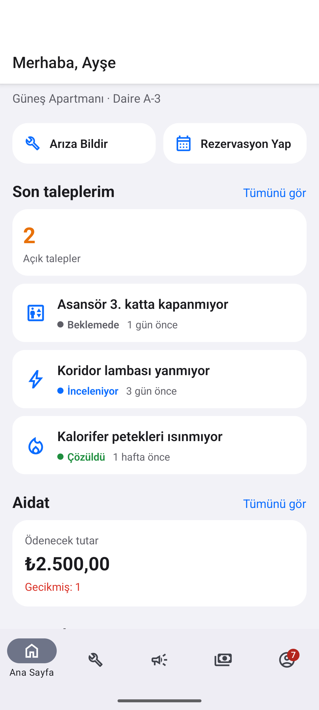<br>Home</td>
    <td align="center">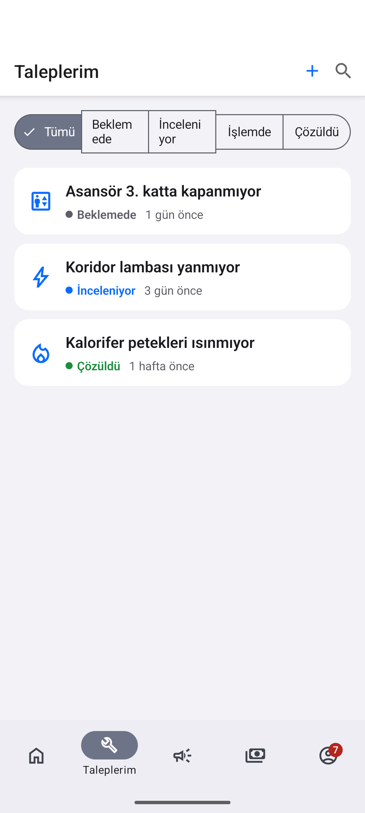<br>Tickets</td>
    <td align="center">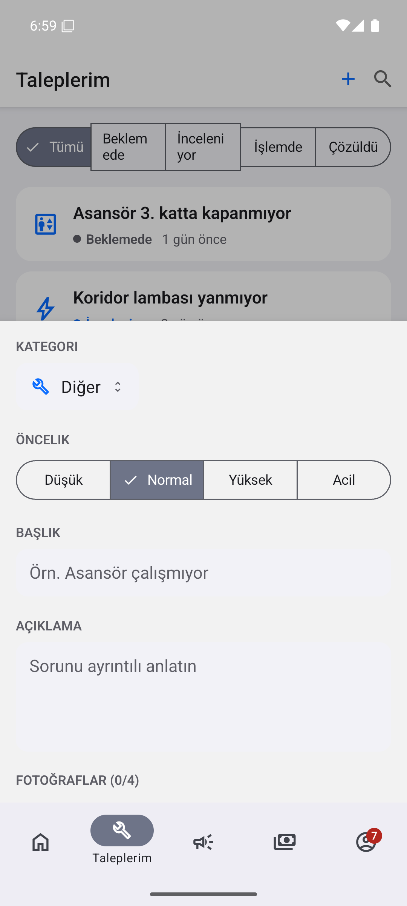<br>New ticket</td>
  </tr>
  <tr>
    <td align="center">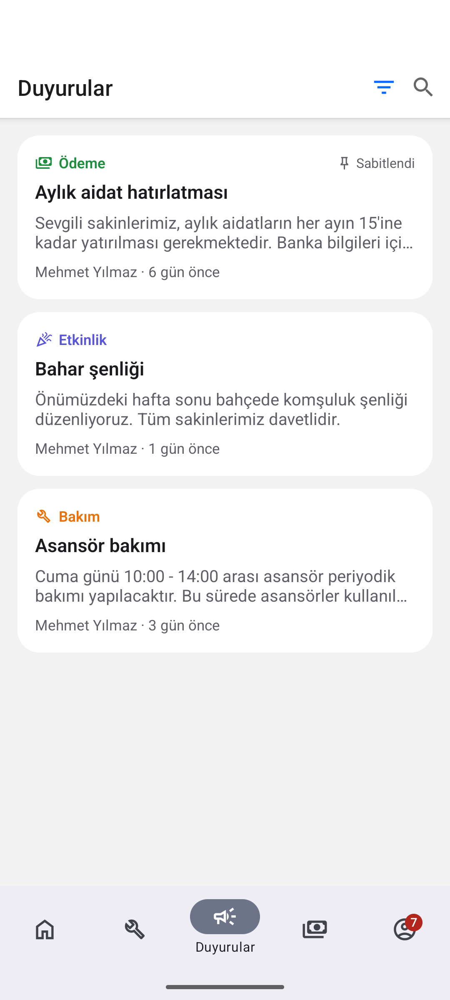<br>Announcements</td>
    <td align="center">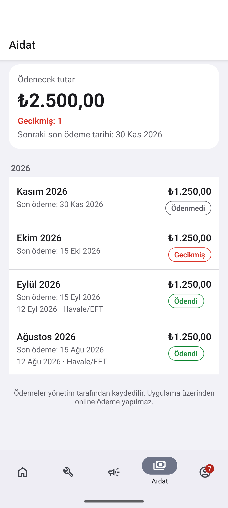<br>Dues</td>
    <td align="center">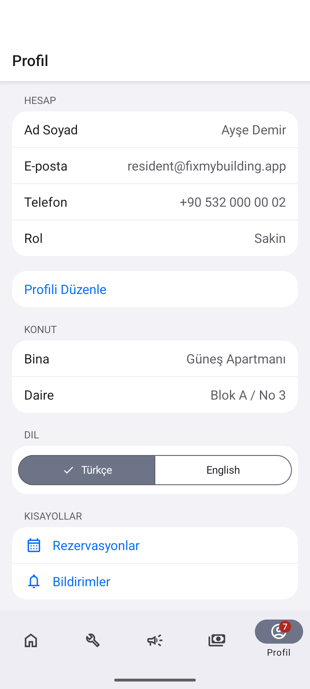<br>Profile</td>
  </tr>
</table>

Dark mode:

<table>
  <tr>
    <td align="center">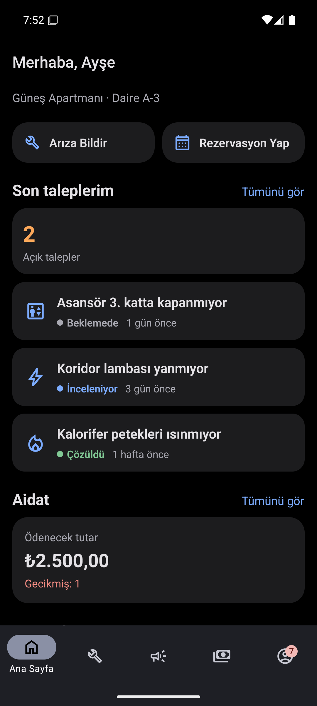<br>Home</td>
    <td align="center">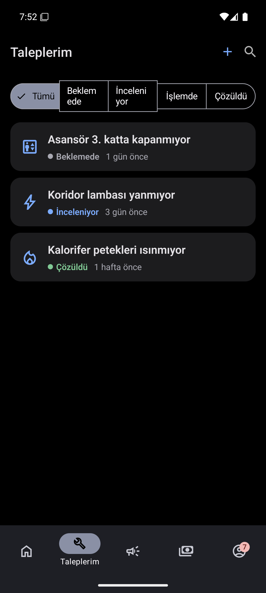<br>Tickets</td>
    <td align="center">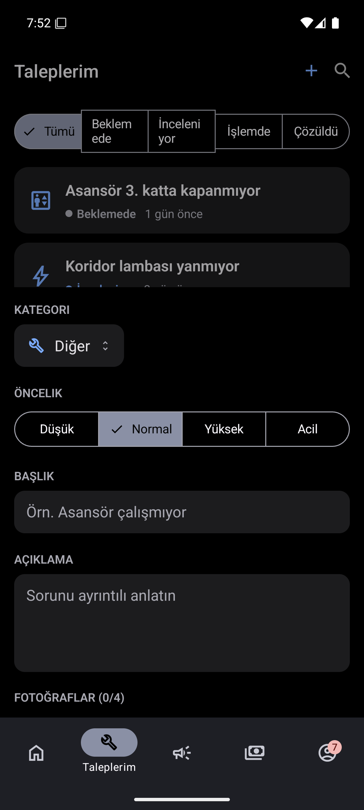<br>New ticket</td>
  </tr>
  <tr>
    <td align="center">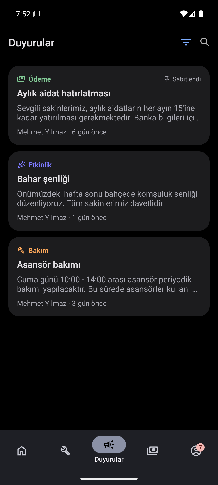<br>Announcements</td>
    <td align="center">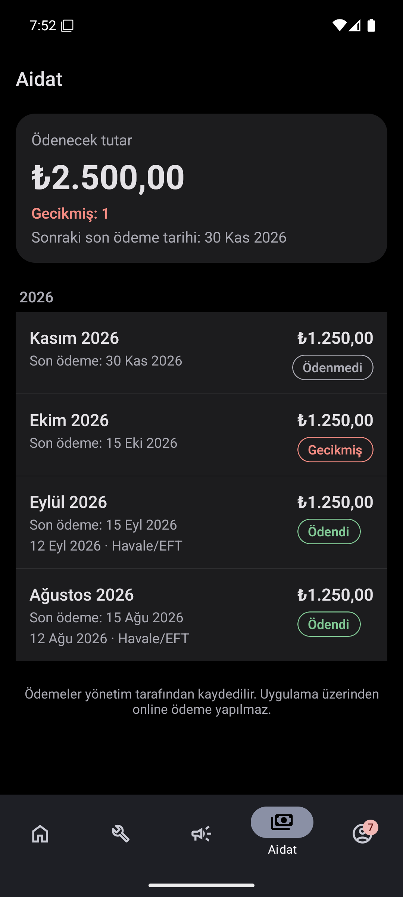<br>Dues</td>
    <td align="center">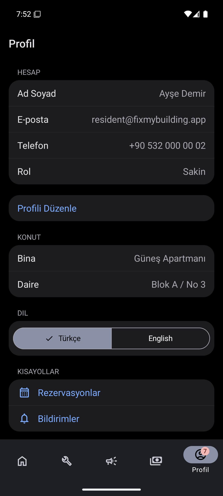<br>Profile</td>
  </tr>
</table>

## Tech stack

| Area | Choice |
|---|---|
| App | React Native 0.88, Expo SDK 58, TypeScript (strict) |
| Navigation | Expo Router, NativeTabs (Liquid Glass tab bar on iOS 26), native stack, formSheet |
| UI | `@expo/ui`, `expo-symbols`, teal-on-paper palette, Outfit font + design tokens, `react-native-reanimated` press motion, dark mode |
| Data | `@supabase/supabase-js`, `@tanstack/react-query` |
| Backend | Supabase: Auth, Postgres + RLS, Storage, Realtime, Edge Functions |
| i18n | i18next, react-i18next, expo-localization (Turkish default, English) |
| Quality | ESLint (`eslint-config-expo`), Prettier, `tsc --noEmit`, `expo-doctor` |

## Architecture

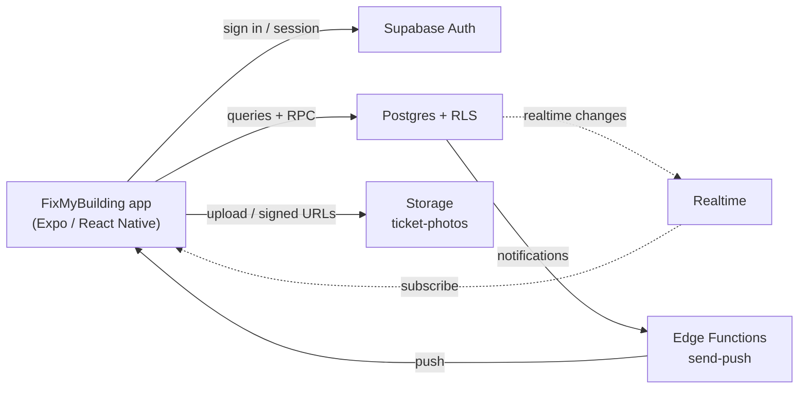

More detail: [docs/architecture.md](docs/architecture.md) and [docs/database.md](docs/database.md).

## Getting started

**Prerequisites:** Node.js 22, a Supabase project, and an iOS or Android device or emulator. Liquid Glass needs an **iOS 26** device; use Expo Go if it supports SDK 58, otherwise an EAS development build. On other versions the app falls back to standard native styling.

```bash
git clone https://github.com/ozgunmutlu0/apartment-management-app.git
cd apartment-management-app
npm install
```

1. Create a project at [supabase.com](https://supabase.com).
2. Apply the migrations in `supabase/migrations/` in order and, for a demo/dev project only, `supabase/seed.sql`. Details: [supabase/README.md](supabase/README.md) (Turkish).
3. In Supabase, enable Email auth (for demos you can disable "Confirm email").
4. Copy the env file and fill in your project URL and anon key:
   ```bash
   cp .env.example .env
   ```
5. Start the app:
   ```bash
   npx expo start
   ```

Optional push notifications need an Edge Function and a few secrets: see [Push notifications setup](supabase/README.md#push-bildirimleri-opsiyonel).

Never put the Supabase service role key in the app. Only `EXPO_PUBLIC_*` variables belong in `.env`.

### Demo accounts

Created by `supabase/seed.sql` (demo/dev projects only; never run the seed in production). Password for all: `Demo1234!`

| Email | Role |
|---|---|
| manager@fixmybuilding.app | manager |
| resident@fixmybuilding.app | resident (Block A / 3, Turkish) |
| resident2@fixmybuilding.app | resident (Block B / 5, English) |
| tech@fixmybuilding.app | technician |

Building invite code: `GUNES1` (Güneş Apartmanı).

### Scripts

```bash
npm run typecheck   # tsc --noEmit
npm run lint        # expo lint
npx expo-doctor
```

## Project structure

```
src/
  app/                 # Expo Router: sign-in, sign-up, (tabs)/(home|tickets|announcements|dues|manage|profile)
  components/          # shared UI (GlassCard, EmptyState, ...)
  features/<feature>/  # api.ts (react-query hooks), types.ts, components/
  lib/                 # supabase client, auth, queryClient, database.types.ts
  i18n/                # i18next setup, locales/{tr,en}/<namespace>.json
  theme/               # colors.ts (teal-on-paper palette), tokens.ts (spacing, radius, Outfit type, elevation)
supabase/
  migrations/          # schema, functions/triggers, RLS, storage/realtime, join building, notifications/push
  seed.sql             # demo data
docs/                  # architecture, database, project report (TR), screenshots
```

## Roadmap

| Phase | Scope | Status |
|---|---|---|
| Aşama 1 | Project definition and requirements | Done |
| Aşama 2 | Design: roles, screens, data model, navigation | Done |
| Aşama 3 | Foundation: skeleton, Supabase schema/RLS, auth and roles | Done (implemented) |
| Aşama 4 | Required features: tickets with photos, request tracking, announcements | Done (implemented) |
| Aşama 5 | Second phase: dues, notifications (realtime + push), extras: dashboard, reservations, reports | Done (implemented) |
| Aşama 6 | Test: static QA done (typecheck, lint, expo-doctor, iOS export pass); Android relative-time fallback and role-based initial route fixed; device and live Supabase testing | In progress |
| Aşama 7 | Documentation, final checks, delivery | Planned |

Work packages and rules: [PLAN.md](PLAN.md). Turkish project definition: [docs/project-report-tr.md](docs/project-report-tr.md).

## Contributing

See [CONTRIBUTING.md](CONTRIBUTING.md). AI-assisted development guidelines are in [CLAUDE.md](CLAUDE.md).

## Türkçe Özet

**FixMyBuilding**, apartman sakinleri, yöneticiler ve teknisyenler için geliştirilmiş bir apartman yönetim uygulamasıdır. WhatsApp grupları ve telefon görüşmeleri yerine arıza bildirimi (fotoğraflı), talep takibi (Beklemede, İnceleniyor, İşlemde, Çözüldü), duyurular, aidat takibi, bildirimler ve ortak alan rezervasyonunu tek uygulamada sunar.

- Teknoloji: React Native + Expo SDK 58, TypeScript, Supabase (Auth, Postgres + RLS, Storage, Realtime).
- iOS 26'da Liquid Glass için yerel bileşenler (NativeTabs, formSheet, expo-glass-effect); Türkçe (varsayılan) ve İngilizce.
- Öncelikler: zorunlu = giriş/roller, arıza, talep takibi, duyuru; ikinci aşama = aidat, bildirim; ekstra = rezervasyon, raporlar.
- Durum: tüm özellikler geliştirildi (statik kontroller geçti); cihaz ve gerçek Supabase üzerinde test aşaması (Aşama 6) sürüyor.
- Detaylı proje tanımı: [docs/project-report-tr.md](docs/project-report-tr.md). Kurulum için yukarıdaki "Getting started" bölümüne ve [supabase/README.md](supabase/README.md) dosyasına bakın.

## License

[MIT](LICENSE) &copy; 2026 Özgün Mutlu
