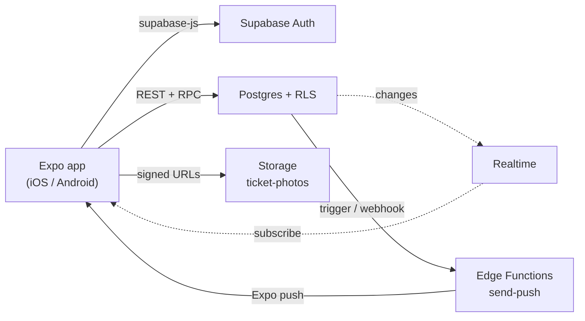

# Architecture

## Overview

Authorization lives in the database (RLS, guards, RPCs); the UI only hides what a role cannot do.

## Navigation map

Expo Router, file-based. `src/app/_layout.tsx` wraps providers and gates routes with `Stack.Protected` (signed out: `sign-in`, `sign-up`; signed in without building: join-building; otherwise `(tabs)`).

`(tabs)/_layout.tsx` renders `NativeTabs` (Liquid Glass tab bar on iOS 26, Material navigation on Android). Triggers are hidden per role:

| Tab group | resident | manager | technician |
|---|---|---|---|
| `(home)` | Home | Home | Home |
| `(tickets)` | My tickets (+ new ticket sheet) | All tickets | Assigned jobs |
| `(announcements)` | read | read, create/edit (sheet) | read |
| `(dues)` | Dues | hidden | hidden |
| `(manage)` | hidden | Manage: dues, reports | hidden |
| `(profile)` | Profile, reservations, notifications | same | same |

Each group has its own native `Stack` layout. Creation forms use `presentation: 'formSheet'` with `sheetAllowedDetents`.

## Data flow

1. Screen calls a hook from `src/features/<feature>/api.ts`.
2. The hook uses `supabase` from `src/lib/supabase.ts` through react-query.
3. Postgres applies RLS for the signed-in user and returns only permitted rows.
4. Mutations call RPCs (status, assign, note) or insert rows allowed by RLS; triggers write events and notifications.
5. Mutations invalidate related query keys (ticket and dues mutations also refresh the manager reports); Realtime updates (notifications, tickets) also invalidate keys.

Session tokens are stored with `expo-secure-store` (AsyncStorage fallback for large values).

## react-query conventions

- One `QueryClient` in `src/lib/queryClient.ts`.
- Query keys are arrays, namespaced by feature: `['tickets', 'list', filters]`, `['tickets', 'detail', id]`, `['announcements', 'list']`.
- Hooks are named `useTickets`, `useTicket(id)`, `useCreateTicket`, ...; mutations invalidate by feature prefix (`['tickets']`).
- Hooks return typed data using `database.types.ts`; no raw Supabase calls inside screens.
- Handle loading, error and empty states in every list (`EmptyState` component).

## i18n

`i18next` + `react-i18next` + `expo-localization`. Turkish is the default, English the second language. Strings live in `src/i18n/locales/{tr,en}/<namespace>.json`, one namespace per feature (`common`, `auth`, `tabs`, `home`, `tickets`, `announcements`, `dues`, `manage`, `profile`). Every user-facing string uses `t('key')` and both languages are updated together. The language can be changed in Profile and is stored in `profiles.locale`.

## UI principles

Native-first: NativeTabs, native stack headers (large titles, search bars), formSheet modals, `expo-glass-effect` for glass surfaces with a `PlatformColor` card fallback, `@expo/ui` for native controls, SF Symbols via `expo-symbols`. Colors come from `src/theme/colors.ts`; dark mode is supported everywhere.
