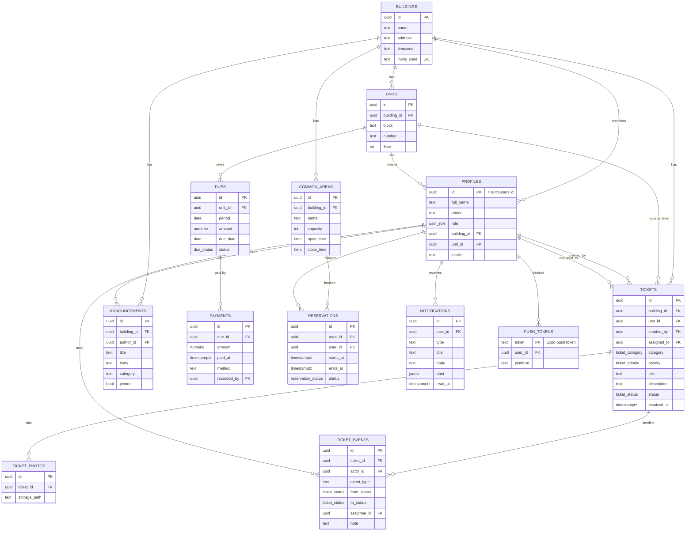

# Database

Postgres on Supabase. Source of truth: [`supabase/migrations/`](../supabase/migrations) (applied in timestamp order). Setup and demo data: [`supabase/README.md`](../supabase/README.md) (Turkish).

## ER diagram

All tables also have `created_at`; `profiles`, `tickets` and `announcements` have an auto-maintained `updated_at`.

## Enums

| Enum | Values |
|---|---|
| `user_role` | `resident`, `manager`, `technician` |
| `ticket_status` | `pending`, `in_review`, `in_progress`, `resolved` |
| `ticket_category` | `elevator`, `plumbing`, `electrical`, `cleaning`, `common_area`, `heating`, `other` |
| `ticket_priority` | `low`, `normal`, `high`, `urgent` |
| `due_status` | `unpaid`, `paid`, `overdue` |
| `reservation_status` | `confirmed`, `cancelled` |

Text columns with check constraints: `ticket_events.event_type` (`created`, `status`, `assignment`, `note`), `announcements.category` (`general`, `maintenance`, `event`, `urgent`, `payment`), `payments.method` (`cash`, `bank_transfer`, `card`, `other`), `profiles.locale` (`tr`, `en`).

Notable constraints: `units` unique `(building_id, block, number)`; `dues` unique `(unit_id, period)` with `period` = first of month; `reservations` exclusion constraint (`btree_gist`) prevents overlapping `confirmed` bookings per area.

## Tables

| Table | Purpose |
|---|---|
| `buildings` | A building; `invite_code` (6 chars, demo `GUNES1`) lets residents join |
| `units` | Apartments of a building |
| `profiles` | One row per auth user (created by signup trigger); role, building, unit, locale |
| `tickets` | Fault reports / requests with status lifecycle |
| `ticket_photos` | Storage paths of ticket photos |
| `ticket_events` | Timeline: created, status change, assignment, note (trigger-written, plus client notes) |
| `announcements` | Building announcements, optionally pinned |
| `dues` / `payments` | Monthly dues per unit and recorded payments |
| `common_areas` / `reservations` | Shared spaces and bookings |
| `notifications` | In-app notifications (also source for push) |
| `push_tokens` | Expo push tokens, one row per device; owner-only (not visible to other building members) |

## RLS matrix

RLS is enabled on every table; all policies target `authenticated`. Scope is always the user's own building (via `current_building_id()`).

| Table | resident | technician | manager |
|---|---|---|---|
| `buildings` / `units` | read own building | read own building | read; update building; write units |
| `profiles` | read own building; update own (not role/building/unit) | same | read building; update role/unit within building |
| `tickets` | read own + own unit's; insert as `pending` | read only assigned; update status only (never back to `pending`) | full within building |
| `ticket_photos` | read/add for visible tickets | same | same |
| `ticket_events` | read for visible tickets | read; add `note` on assigned tickets | read; add `note` |
| `announcements` | read | read | create, update, delete |
| `dues` / `payments` | read own unit | none | full within building |
| `common_areas` | read | read | full |
| `reservations` | read confirmed; manage own | same | read and manage all |
| `notifications` | read/update/delete own | same | same |
| `push_tokens` | read/insert/update/delete own only | same | same |

Storage bucket `ticket-photos` is private; policies derive the ticket from the first path segment and reuse ticket visibility.

## Triggers

| Trigger | Effect |
|---|---|
| `on_auth_user_created` (`handle_new_user`) | Creates the `profiles` row; everyone starts as `resident` |
| `set_updated_at` (profiles, tickets, announcements) | Maintains `updated_at` |
| `profiles_guard` | Blocks self-escalation of role/building/unit (except via `join_building`) |
| `tickets_guard` | Role-specific column limits, assignee must be a technician of the same building, sets `resolved_at` |
| `tickets_after_insert` | Writes `created` event; notifies building managers |
| `tickets_after_update` | Writes `status` / `assignment` events; notifies creator or assignee |
| `announcements_after_insert` | Notifies all other building members |
| `payments_after_change` | Recomputes `dues.status` (`paid` when settled) |
| `reservations_validate` | Validates opening hours and rules |

## RPCs and helpers

| Function | Caller | Purpose |
|---|---|---|
| `update_ticket_status(p_ticket_id, p_status, p_note)` | manager, technician | Change status with optional note |
| `assign_ticket(p_ticket_id, p_technician_id, p_note)` | manager | Assign/unassign (`null`) a technician |
| `add_ticket_note(p_ticket_id, p_note)` | manager, technician | Add a timeline note |
| `get_building_by_invite(p_code)` | authenticated | Building + units for an invite code, or `null` |
| `join_building(p_code, p_unit_id)` | resident without building | Join a building and unit |
| `mark_overdue_dues()` | service role / cron | Mark past-due unpaid dues as `overdue` |
| `register_push_token(p_token, p_platform)` | authenticated | Register this device token for the caller; removes it from any other user (one device = one account) |
| `unregister_push_token(p_token)` | authenticated | Remove the caller's own row for this token (call before sign-out) |
| `current_user_role()`, `current_building_id()`, `current_unit_id()` | RLS helpers | `security definer` lookups |

Never insert into `ticket_events` (except notes through the RPC) or `notifications` from the client.

## Changing the schema

Add a new timestamped file in `supabase/migrations/` and regenerate or update `src/lib/database.types.ts`. Do not edit applied migrations.
